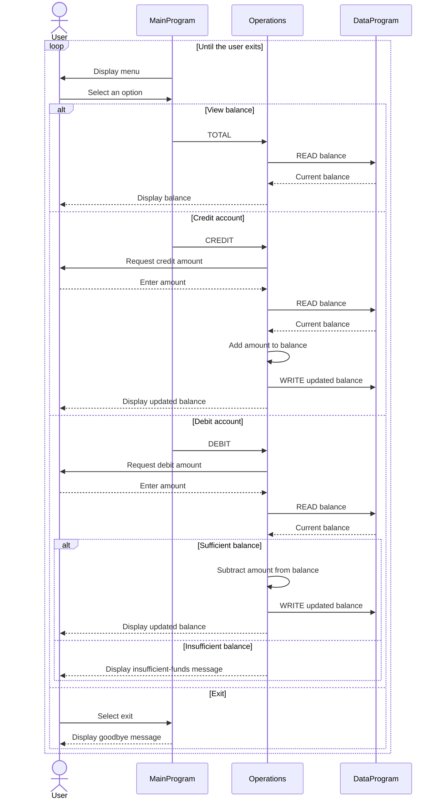

# COBOL Accounting System

This directory documents the legacy accounting application in `src/cobol`.

## Program files

### `main.cob` — `MainProgram`

Provides the command-line menu and controls the application's main loop. Users can view the balance, credit the account, debit the account, or exit. For the first three choices, it calls `Operations` with the corresponding action (`TOTAL`, `CREDIT`, or `DEBIT`). Other menu choices display an error.

### `operations.cob` — `Operations`

Implements the account operations:

- `TOTAL` reads and displays the current balance.
- `CREDIT` asks for an amount, adds it to the balance, saves the result, and displays the new balance.
- `DEBIT` asks for an amount and subtracts it only when the balance is sufficient; otherwise it displays an insufficient-funds message.

It reads and writes the balance by calling `DataProgram`.

### `data.cob` — `DataProgram`

Stores the account balance and provides the read/write interface used by `Operations`. The balance starts at `1000.00` and is held in working storage, so this program does not save it to a file or database.

## Account rules and limitations

- The application maintains one shared account balance; it has no student identifiers or separate balances per student.
- A debit is allowed only if the current balance is at least the requested amount. An insufficient balance leaves the balance unchanged.
- A credit adds the entered amount to the balance.
- Amount fields use a numeric format with two implied decimal places.
- The code does not define student-specific fees, cafeteria accounts, or school-supply purchase rules.
- The balance is initialized when the program starts and is not persisted between runs.

## Application data flow

